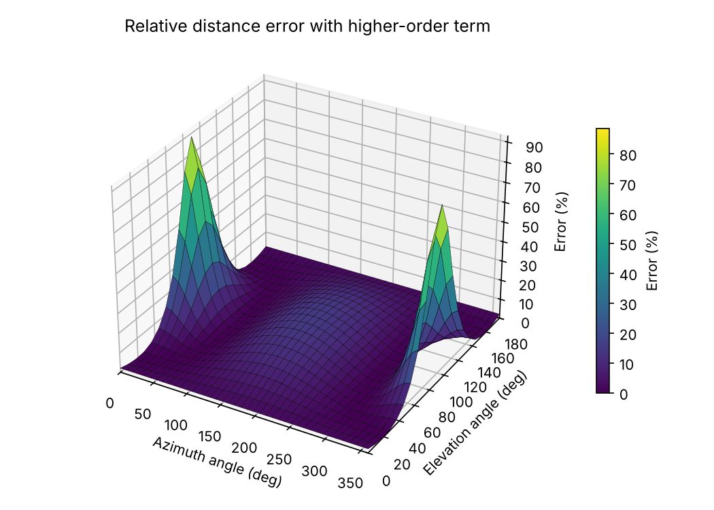

# Massive MIMO for Drone Swarms

Simulation code for a ground-station **massive-MIMO array** serving a **swarm of drones** distributed in 3-D space. It covers:

1. **3-D drone placement**: drones uniformly distributed inside a sphere, checked against the analytical PDFs of elevation, azimuth and distance.
2. **Near-field distance approximation**: how accurate the plane-wave (first-order) and spherical-wave/Fresnel (second-order) approximations of the element-to-drone distance are for a large array.
3. **Interference moments**: Monte-Carlo vs. closed-form first to fourth moments of the normalised inter-drone interference under matched-filter beamforming, as a function of the number of antennas $M$.

The original MATLAB scripts (author: Prabhu Chandhar, Chandhar Research Labs, Chennai, India) are kept in the repository root. The `python/` folder has equivalent Python ports that also save every figure to `figures/`.

## Repository layout

```
.
├── ThreeD_sphere_distribution_ThSim.m                   # MATLAB: drone placement in a sphere
├── ThreeD_Dist_Approximation_error.m                    # MATLAB: distance approximation error
├── ThreeD_sphere_Interference_Distribution_Moments_ThSim.m  # MATLAB: interference moments
├── python/
│   ├── sphere_distribution.py           # port of ThreeD_sphere_distribution_ThSim.m
│   ├── distance_approximation_error.py  # port of ThreeD_Dist_Approximation_error.m
│   └── interference_moments.py          # port of ThreeD_sphere_Interference_Distribution_Moments_ThSim.m
├── figures/                             # generated figures (PNG) and data (CSV)
└── requirements.txt
```

## Getting started

```bash
pip install -r requirements.txt
cd python
python sphere_distribution.py            # ~2 s
python distance_approximation_error.py   # <1 s
python interference_moments.py           # ~25 s (100 000 Monte-Carlo drops)
```

Every script takes command-line options (`--help` lists them). For example, `--show` opens the figures interactively, `--outdir` changes where they are saved, and `interference_moments.py --K 20 --samples 20000` changes the swarm size and the number of drops.

---

## 1. Drones uniformly distributed in a sphere

`python/sphere_distribution.py` (port of `ThreeD_sphere_distribution_ThSim.m`)

The ground-station array sits at the centre of a sphere of radius $R = 1000$ m, and drones are dropped uniformly inside it. In spherical coordinates the elevation $\theta$, azimuth $\phi$ and distance $r$ are independent, with

```math
f_\Theta(\theta) = \frac{\sin\theta}{2},\quad 0 \le \theta \le \pi
\qquad
f_\Phi(\phi) = \frac{1}{2\pi},\quad 0 \le \phi \le 2\pi
\qquad
f_D(r) = \frac{3r^2}{R^3},\quad 0 \le r \le R
```

Samples are generated from $u_1, u_2, u_3 \sim \mathcal{U}(0,1)$ as

```math
\theta = \arcsin(2u_1 - 1) + \frac{\pi}{2}, \qquad \phi = 2\pi u_2, \qquad r = R\,u_3^{1/3}.
```

With $10^6$ samples, the histograms match the theoretical PDFs:

| Elevation | Azimuth |
|---|---|
|  |  |
| **Distance** | **Drone positions (first 1000)** |
|  |  |

## 2. Near-field distance approximation error

`python/distance_approximation_error.py` (port of `ThreeD_Dist_Approximation_error.m`)

Setup: a $100 \times 1$ array at 2.5 GHz with element spacing $1.5\lambda$ (an aperture of about 18 m), and a drone at $R = 25$ m from the first element, in direction $(\theta, \phi)$. For element $(p, q)$ define

```math
a_{pq}^2 = \big((p-1)\Delta_x\big)^2 + \big((q-1)\Delta_y\big)^2,
\qquad
b_{pq} = (p-1)\Delta_x\cos\phi + (q-1)\Delta_y\sin\phi .
```

The three distance models are

**Exact**

```math
d_{pq} = R\sqrt{1 + \frac{a_{pq}^2}{R^2} - \frac{2\sin\theta\, b_{pq}}{R}}
```

**With higher-order term** (spherical wave / Fresnel)

```math
d_{pq} \approx R + \frac{a_{pq}^2}{2R} - \sin\theta\, b_{pq}
```

**Without higher-order term** (plane wave / far field)

```math
d_{pq} \approx R - \sin\theta\, b_{pq}
```


When the drone is broadside to the array ($\sin\theta \approx 0$), the plane-wave model predicts the same distance to every element. The exact distance grows quadratically across the aperture, and the second-order term follows it closely.

Relative error (%) at the farthest element, over every elevation/azimuth direction:

| With higher-order term | Without higher-order term |
|---|---|
|  |  |

The second-order model is accurate over most directions. Its error peaks only where the drone lies almost along the array axis ($\theta \approx 90^\circ$, $\phi \approx 0^\circ$ or $360^\circ$), because there the farthest element is very close to the drone and the Taylor expansion breaks down. The plane-wave model has a moderate error over a much wider range of directions. Large arrays serving nearby drones therefore need the spherical-wave model.

## 3. Moments of the normalised interference

`python/interference_moments.py` (port of `ThreeD_sphere_Interference_Distribution_Moments_ThSim.m`)

$K = 10$ drones are uniformly distributed in a sphere of radius 1000 m and served by an $M$-element ULA (spacing $\delta = \lambda/2$, 2.4 GHz). Drone $k$ is at distance $d_k$ with direction cosine $z_k = \sin\theta_k\cos\phi_k$, and its spherical-wave channel is

```math
g_k[m] = \exp\!\left(-j\frac{2\pi}{\lambda}\left(d_k + \frac{m^2\delta^2}{2d_k} - (m-1)\,\delta\, z_k\right)\right),
\qquad m = 1, \dots, M .
```

With matched-filter beamforming towards drone 1, the normalised interference is

```math
U = \frac{1}{M^2}\sum_{j=2}^{K}\left|\mathbf{g}_j\,\mathbf{g}_1^{H}\right|^2 .
```

The first two moments have the closed forms

```math
\mathbb{E}[U] = \frac{K-1}{M},
\qquad
\mathbb{E}[U^2] = \frac{(K-1)\left(\frac{2}{3}M^3 + \frac{1}{3}M\right) + (K-1)(K-2)\,M^2}{M^4}.
```

The script also implements the closed forms for $\mathbb{E}[U^3]$ and $\mathbb{E}[U^4]$ from the MATLAB code and compares all four moments with a 100 000-drop Monte-Carlo simulation:


Simulation and theory agree for every $M$ from 10 to 100. The interference falls roughly as $1/M$, which is the favourable-propagation effect that makes massive MIMO attractive for serving dense drone swarms. The numbers behind the plot are in [`figures/interference_moments.csv`](figures/interference_moments.csv).

## Credits

Original MATLAB code: Prabhu Chandhar, Chandhar Research Labs, Chennai, India.
