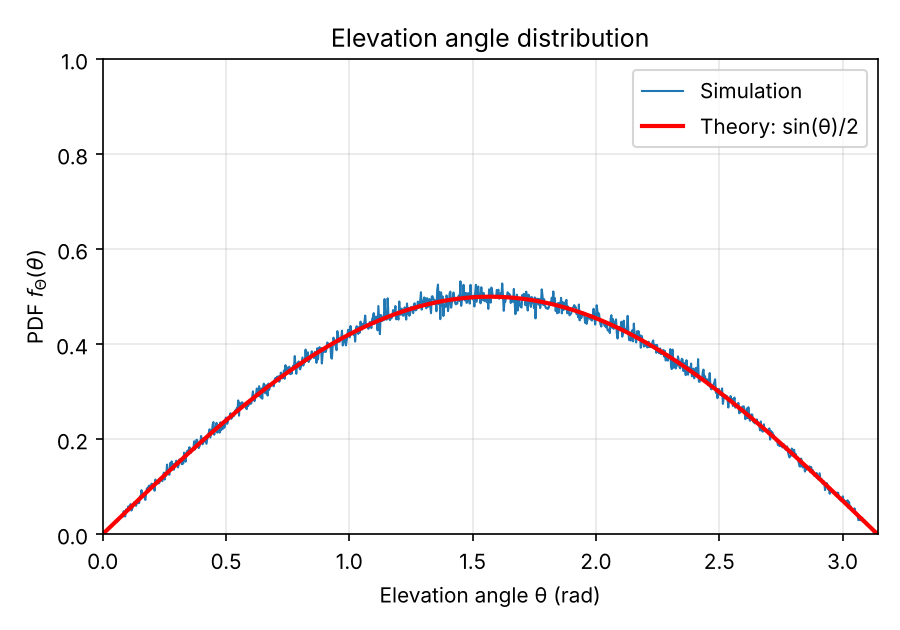
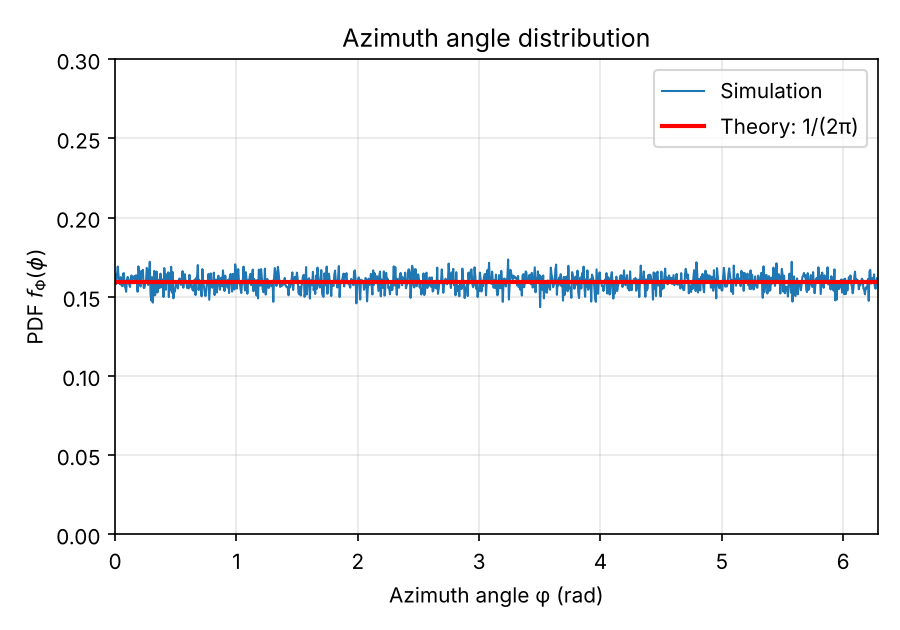
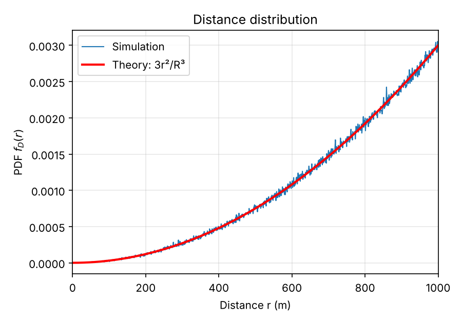
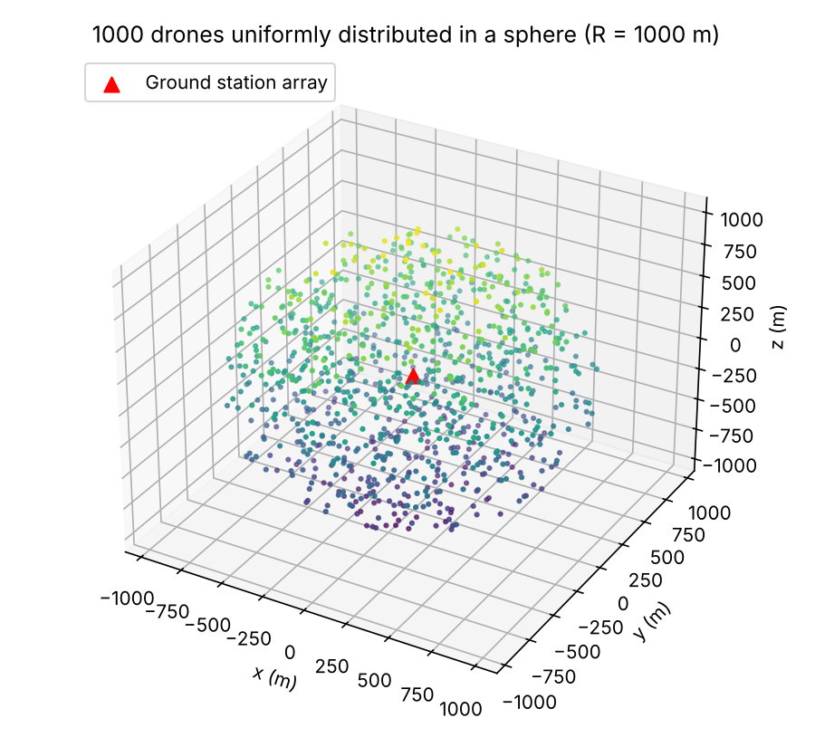
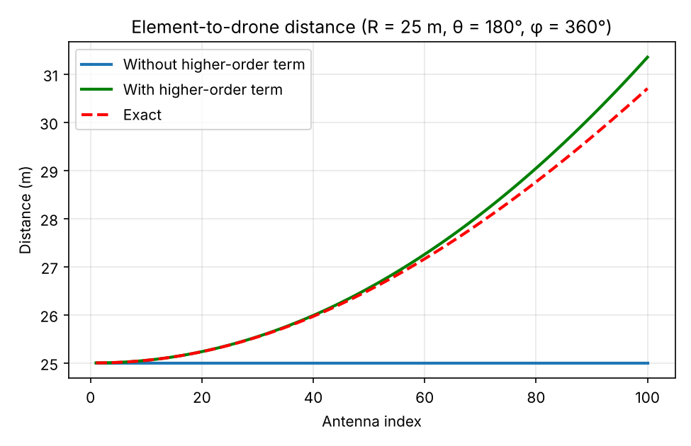
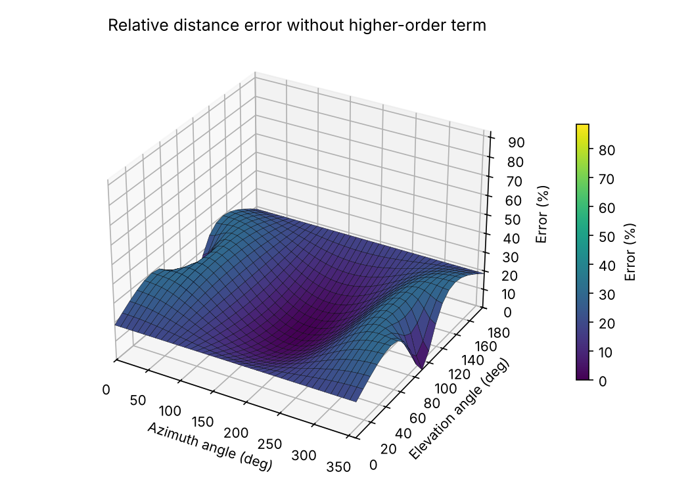
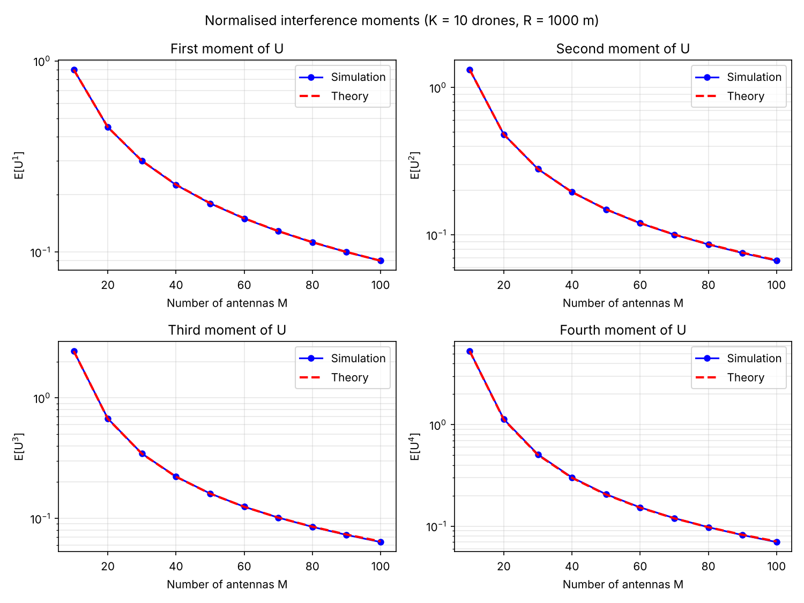

# Massive MIMO for Drone Swarms

Simulation code for a ground-station **massive-MIMO array** serving a **swarm of drones** distributed in 3-D space. It covers:

1. **3-D drone placement**: drones uniformly distributed inside a sphere, checked against the analytical PDFs of elevation, azimuth and distance.
2. **Near-field distance approximation**: how accurate the plane-wave (first-order) and spherical-wave/Fresnel (second-order) approximations of the element-to-drone distance are for a large array.
3. **Interference moments**: Monte-Carlo vs. closed-form first to fourth moments of the normalised inter-drone interference under matched-filter beamforming, as a function of the number of antennas *M*.

The original MATLAB scripts (author: Prabhu Chandhar, Chandhar Research Labs, Chennai, India) are kept in the repository root. The `python/` folder has equivalent Python ports that also save every figure to `figures/`.

## Repository layout

```
.
├── ThreeD_sphere_distribution_ThSim.m                   # MATLAB: drone placement in a sphere
├── ThreeD_Dist_Approximation_error.m                    # MATLAB: distance approximation error
├── ThreeD_sphere_Interference_Distribution_Moments_ThSim.m  # MATLAB: interference moments
├── python/
│   ├── sphere_distribution.py           # port of ThreeD_sphere_distribution_ThSim.m
│   ├── distance_approximation_error.py  # port of ThreeD_Dist_Approximation_error.m
│   └── interference_moments.py          # port of ThreeD_sphere_Interference_Distribution_Moments_ThSim.m
├── figures/                             # generated figures (PNG) and data (CSV)
└── requirements.txt
```

## Getting started

```bash
pip install -r requirements.txt
cd python
python sphere_distribution.py            # ~2 s
python distance_approximation_error.py   # <1 s
python interference_moments.py           # ~25 s (100 000 Monte-Carlo drops)
```

Every script takes command-line options (`--help` lists them). For example, `--show` opens the figures interactively, `--outdir` changes where they are saved, and `interference_moments.py --K 20 --samples 20000` changes the swarm size and the number of drops.

---

## 1. Drones uniformly distributed in a sphere

`python/sphere_distribution.py` (port of `ThreeD_sphere_distribution_ThSim.m`)

The ground-station array sits at the centre of a sphere of radius *R* = 1000 m, and drones are dropped uniformly inside it. In spherical coordinates the elevation θ, azimuth φ and distance *r* are independent, with

| Variable | PDF | Support |
|---|---|---|
| Elevation θ | f<sub>Θ</sub>(θ) = sin(θ) / 2 | 0 ≤ θ ≤ π |
| Azimuth φ | f<sub>Φ</sub>(φ) = 1 / (2π) | 0 ≤ φ ≤ 2π |
| Distance r | f<sub>D</sub>(r) = 3r² / R³ | 0 ≤ r ≤ R |

Samples are drawn as θ = arcsin(2u₁ − 1) + π/2, φ = 2πu₂ and r = R·u₃<sup>1/3</sup>, with u<sub>i</sub> ~ U(0, 1). With 10⁶ samples, the histograms match the theoretical PDFs:

| Elevation | Azimuth |
|---|---|
|  |  |
| **Distance** | **Drone positions (first 1000)** |
|  |  |

## 2. Near-field distance approximation error

`python/distance_approximation_error.py` (port of `ThreeD_Dist_Approximation_error.m`)

Setup: a 100 × 1 array at 2.5 GHz with element spacing 1.5λ (an aperture of about 18 m), and a drone at *R* = 25 m from the first element. For element (p, q) let a²<sub>pq</sub> = ((p−1)Δx)² + ((q−1)Δy)² and b<sub>pq</sub> = (p−1)Δx cos φ + (q−1)Δy sin φ. The three distance models are

| Model | Expression |
|---|---|
| Exact | R √(1 + a²<sub>pq</sub>/R² − 2 sin θ · b<sub>pq</sub>/R) |
| With higher-order term (spherical wave) | R + a²<sub>pq</sub>/(2R) − sin θ · b<sub>pq</sub> |
| Without higher-order term (plane wave) | R − sin θ · b<sub>pq</sub> |



When the drone is broadside to the array (sin θ ≈ 0), the plane-wave model predicts the same distance to every element. The exact distance grows quadratically across the aperture, and the second-order term follows it closely.

Relative error (%) at the farthest element, over every elevation/azimuth direction:

| With higher-order term | Without higher-order term |
|---|---|
|  |  |

The second-order model is accurate over most directions. Its error peaks only where the drone lies almost along the array axis (θ ≈ 90°, φ ≈ 0°/360°), because there the farthest element is very close to the drone and the Taylor expansion breaks down. The plane-wave model has a moderate error over a much wider range of directions. Large arrays serving nearby drones therefore need the spherical-wave model.

## 3. Moments of the normalised interference

`python/interference_moments.py` (port of `ThreeD_sphere_Interference_Distribution_Moments_ThSim.m`)

*K* = 10 drones are uniformly distributed in a sphere of radius 1000 m and served by an *M*-element ULA (spacing λ/2, 2.4 GHz). The spherical-wave channel of drone *k* (distance d<sub>k</sub>, direction cosine z<sub>k</sub> = sin θ<sub>k</sub> cos φ<sub>k</sub>) is

g<sub>k</sub>[m] = exp(−j 2π/λ · (d<sub>k</sub> + m²δ²/(2d<sub>k</sub>) − (m−1)δ z<sub>k</sub>)), m = 1, …, M.

With matched-filter beamforming towards drone 1, the normalised interference is

**U = (1/M²) · Σ<sub>j=2…K</sub> |g<sub>j</sub> g<sub>1</sub><sup>H</sup>|²**.

The first moment has the simple closed form E[U] = (K − 1)/M. The script also implements the closed forms for E[U²], E[U³] and E[U⁴] from the MATLAB code and compares all four with a 100 000-drop Monte-Carlo simulation:



Simulation and theory agree for every *M* from 10 to 100. The interference falls roughly as 1/M, which is the favourable-propagation effect that makes massive MIMO attractive for serving dense drone swarms. The numbers behind the plot are in [`figures/interference_moments.csv`](figures/interference_moments.csv).

## Credits

Original MATLAB code: Prabhu Chandhar, Chandhar Research Labs, Chennai, India.
